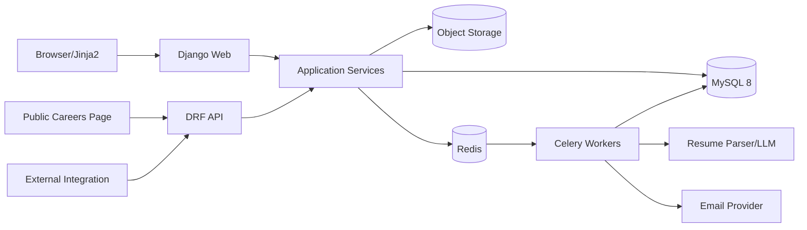

# Product Requirements Document
## Project #5 — ATS Resume Parser

**Status:** Draft siap implementasi  
**Framework utama:** Django  
**Frontend:** Django Jinja2 backend + Tailwind CSS + Alpine.js/HTMX  
**Database:** MySQL 8  
**Asynchronous processing:** Celery + Redis  
**File storage:** S3-compatible object storage  
**Target pengguna:** Recruiter, HR Admin, Interviewer, Hiring Manager, dan Organization Admin

---

## 1. Ringkasan Produk

ATS Resume Parser adalah Applicant Tracking System yang mengelola lowongan, kandidat, resume, pipeline rekrutmen, interview, scorecard, feedback, komunikasi, offer, dan audit trail. Sistem juga mengekstrak data resume, menghitung kecocokan kandidat terhadap lowongan, dan membantu recruiter menyaring kandidat tanpa menggantikan keputusan manusia.

Django dipilih karena domain memiliki relasi data yang kompleks, workflow bertingkat, permission per role, kebutuhan back-office, dan audit. Django Admin digunakan sebagai operational back-office, sedangkan UI utama dibangun khusus menggunakan Jinja2 dan Tailwind CSS.

### 1.1 Nilai utama

- Satu sumber data kandidat dan proses hiring.
- Pipeline visual yang mudah dipakai recruiter.
- Resume parsing dan deduplication.
- Role dan permission yang jelas.
- Scorecard terstruktur untuk mengurangi feedback bias.
- Audit trail untuk perubahan proses.
- Laporan funnel dan time-to-hire.
- API untuk careers page dan integrasi HR.

### 1.2 Prinsip produk

1. **Structured hiring:** tahapan dan scorecard mengikuti konfigurasi lowongan.
2. **Human decision:** AI hanya rekomendasi, bukan keputusan otomatis.
3. **Privacy first:** data kandidat diperlakukan sebagai data sensitif.
4. **Auditability:** perubahan stage, rejection, offer, dan permission tercatat.
5. **Configuration over code:** pipeline, reason, template, dan scorecard dapat dikonfigurasi.
6. **Fast recruiter workflow:** operasi umum dapat dilakukan tanpa banyak klik.

---

## 2. Tujuan dan Non-Tujuan

### 2.1 Tujuan MVP

- Organization dan user management.
- Role: Super Admin, HR Admin, Recruiter, Hiring Manager, Interviewer.
- CRUD department, location, employment type, dan job.
- Publish/unpublish job.
- Candidate profile dan resume upload.
- Resume parsing asynchronous.
- Candidate deduplication.
- Application per job.
- Customizable pipeline stages.
- Kanban pipeline.
- Move candidate antar stage dengan audit.
- Interview scheduling dan feedback.
- Scorecard.
- Email template dan email log.
- Rejection reason.
- Offer status.
- Search dan filter kandidat.
- Dashboard dan funnel report.
- Django Admin untuk back-office.
- REST API untuk careers page dan application intake.

### 2.2 Non-Tujuan MVP

- Payroll.
- Employee onboarding penuh.
- Video interview platform.
- Background check native.
- E-signature native.
- Marketplace kandidat.
- AI automatic rejection.
- Multi-country legal compliance automation penuh.

---

## 3. Persona dan Role

| Role | Tanggung jawab | Hak utama |
|---|---|---|
| Organization Admin | Konfigurasi tenant, user, security | Semua fitur organisasi |
| HR Admin | Kebijakan dan reporting | Job, kandidat, report, configuration |
| Recruiter | Menjalankan pipeline | Kandidat, aplikasi, komunikasi, interview |
| Hiring Manager | Memiliki lowongan dan keputusan | Review kandidat, scorecard, approval |
| Interviewer | Melakukan interview | Jadwal dan scorecard yang ditugaskan |
| Auditor/Read-only | Compliance | Read-only data dan audit |

### 3.1 Permission codename

- `jobs.view_job`
- `jobs.add_job`
- `jobs.change_job`
- `jobs.publish_job`
- `candidates.view_candidate`
- `candidates.add_candidate`
- `candidates.change_candidate`
- `candidates.export_candidate`
- `applications.move_stage`
- `applications.reject_application`
- `interviews.schedule_interview`
- `interviews.submit_scorecard`
- `offers.create_offer`
- `offers.approve_offer`
- `reports.view_report`
- `settings.manage_organization`
- `audit.view_auditlog`

### 3.2 Object-level access

- Interviewer hanya melihat kandidat dan interview yang ditugaskan.
- Hiring manager hanya melihat lowongan yang dimiliki atau di-share.
- Recruiter dapat dibatasi berdasarkan department/location.
- Candidate source tertentu dapat dibatasi.
- Gunakan policy service dan queryset scoping; tidak hanya template hiding.

---

## 4. Domain dan Workflow

### 4.1 Status lowongan

```text
DRAFT
→ PENDING_APPROVAL
→ OPEN
→ PAUSED
→ CLOSED
→ ARCHIVED
```

### 4.2 Status application

```text
ACTIVE
REJECTED
WITHDRAWN
HIRED
ARCHIVED
```

### 4.3 Pipeline default

1. Applied.
2. Screening.
3. Recruiter Interview.
4. Assessment.
5. Hiring Manager Interview.
6. Panel Interview.
7. Reference Check.
8. Offer.
9. Hired.

Setiap job dapat memiliki pipeline sendiri.

### 4.4 Candidate vs Application

- `Candidate` adalah orang.
- `Application` adalah pencalonan candidate pada satu job.
- Satu candidate dapat memiliki banyak application.
- Resume dapat berbeda per application.
- Status pipeline berada pada application, bukan candidate.

### 4.5 Resume parsing

Pipeline:
1. Upload.
2. Virus scan.
3. Text extraction/OCR.
4. Section detection.
5. Contact extraction.
6. Experience extraction.
7. Education extraction.
8. Skills extraction.
9. Normalization.
10. Deduplication candidate.
11. Job matching.
12. Review.

---

## 5. User Journey Utama

### 5.1 Membuat lowongan

1. Recruiter membuat draft.
2. Memilih department, hiring manager, location, headcount.
3. Menulis description dan requirements.
4. Memilih pipeline template.
5. Membuat scorecard.
6. Mengirim approval bila diperlukan.
7. Lowongan dipublish ke careers page.
8. Sistem membuat public URL dan API representation.

### 5.2 Menambahkan kandidat

Sumber:
- Public careers page.
- Upload manual.
- Email ingestion.
- Referral.
- Agency.
- API.

Flow:
1. Resume diunggah.
2. Parser mengekstrak profil.
3. Sistem mencari duplicate.
4. Recruiter mengonfirmasi merge atau create.
5. Application dibuat.
6. Kandidat masuk stage Applied.

### 5.3 Screening

1. Recruiter membuka applicant list atau kanban.
2. Filter berdasarkan skill, experience, source, location, score.
3. Membuka candidate side panel.
4. Membaca resume, parsed data, notes, activity.
5. Move stage, reject, request interview, atau add tag.
6. Action tercatat di audit dan activity feed.

### 5.4 Interview

1. Recruiter membuat interview plan.
2. Memilih interviewer, waktu, format, dan scorecard.
3. Undangan dikirim.
4. Interviewer membuka agenda.
5. Setelah interview, feedback dikunci setelah submit.
6. Hiring manager melihat aggregate score dan comment.

### 5.5 Offer

1. Recruiter membuat draft offer.
2. Sistem mengisi template.
3. Approval dilakukan sesuai aturan.
4. Offer dikirim.
5. Status: sent, viewed, accepted, declined, expired.
6. Application menjadi Hired setelah accepted dan final confirmation.

---

## 6. Information Architecture

### 6.1 Navigasi utama

- Dashboard
- Jobs
- Candidates
- Pipeline
- Interviews
- Tasks
- Reports
- Email
- Settings
- Admin Back-office

### 6.2 Struktur halaman

```text
/app
├── dashboard
├── jobs
│   ├── list
│   ├── create
│   └── detail/:id
│       ├── overview
│       ├── applicants
│       ├── pipeline
│       ├── scorecard
│       ├── team
│       ├── activity
│       └── settings
├── candidates
│   ├── list
│   └── detail/:id
│       ├── profile
│       ├── resume
│       ├── applications
│       ├── interviews
│       ├── notes
│       └── activity
├── pipeline
├── interviews
├── tasks
├── reports
├── email
└── settings
```

---

## 7. Draft Design UI Modern

### 7.1 Arah visual

- Gaya: modern B2B SaaS.
- Prioritas: readability, scanability, quick actions.
- Sidebar desktop dan compact navigation mobile.
- Surface putih, background slate muda.
- Primary color: violet/indigo.
- Status pipeline memakai badge warna dengan label teks.
- Drag-and-drop memiliki fallback menu.
- Detail kandidat memakai side panel agar recruiter tidak kehilangan konteks list.

### 7.2 Design token

```text
Background       : slate-50
Surface          : white
Text primary     : slate-900
Text secondary   : slate-600
Border           : slate-200
Primary          : violet-600
Success          : emerald-600
Warning          : amber-500
Danger           : rose-600
Info             : sky-600
```

### 7.3 Komponen inti

- App shell.
- KPI card.
- Job card.
- Candidate avatar.
- Candidate table.
- Pipeline kanban.
- Stage column.
- Candidate drawer.
- Resume viewer.
- Skill chip.
- Match score badge.
- Timeline.
- Activity composer.
- Interview card.
- Scorecard form.
- Approval banner.
- Email composer.
- Filter builder.
- Saved view selector.
- Bulk action toolbar.
- Confirmation modal.
- Audit diff viewer.

### 7.4 Dashboard

KPI:
- Open jobs.
- Active candidates.
- Interviews this week.
- Offers pending.
- Average time-to-hire.
- Candidate response SLA.

Panel:
- Hiring funnel.
- Jobs requiring attention.
- Upcoming interviews.
- Tasks.
- Recent activity.
- Source performance.

### 7.5 Jobs List

- Tabs: All, Draft, Open, Paused, Closed.
- Search dan saved filters.
- Card/table toggle.
- Kolom: title, department, location, owner, applicants, stage health, age, status.
- Quick actions: view pipeline, add candidate, pause, duplicate, close.

### 7.6 Job Detail

Header:
- Job title.
- Status.
- Hiring team.
- Headcount progress.
- Publish URL.
- Action menu.

Tabs:
- Overview.
- Applicants.
- Pipeline.
- Scorecard.
- Team.
- Activity.
- Settings.

### 7.7 Pipeline Kanban

```text
┌──────────┬───────────┬────────────┬───────────┬─────────┐
│ Applied  │ Screening │ Interview  │ Assessment│ Offer   │
│ card     │ card      │ card       │ card      │ card    │
└──────────┴───────────┴────────────┴───────────┴─────────┘
```

Candidate card:
- Name.
- Current title/company.
- Source.
- Applied age.
- Match score.
- Alert indicator.
- Assigned recruiter.
- Last activity.

Interaction:
- Drag candidate antar column.
- Drop membuka confirmation jika stage membutuhkan data.
- Move stage memiliki fallback menu.
- Optimistic UI hanya setelah permission check.
- Invalid move menampilkan alasan.

### 7.8 Candidate Detail

Layout:
- Left: profile summary dan contact.
- Center: resume/profile/activity.
- Right: current applications dan quick actions.

Tabs:
- Overview.
- Resume.
- Applications.
- Interviews.
- Notes.
- Emails.
- Activity.

Privacy:
- Contact field dapat dimasking untuk role tertentu.
- Download resume diaudit.
- Data deletion request memiliki workflow.

### 7.9 Interview dan Scorecard

- Calendar/list view.
- Detail agenda.
- Interview kit.
- Competency rating.
- Evidence text wajib untuk rating ekstrem.
- Overall recommendation.
- Save draft.
- Submit and lock.
- Conflict-of-interest checkbox.
- Feedback tidak terlihat antar interviewer sebelum submit bila blind mode aktif.

### 7.10 Reports

- Funnel conversion.
- Time in stage.
- Time to hire.
- Source quality.
- Diversity metric hanya bila legal dan diizinkan.
- Interviewer completion.
- Offer acceptance.
- CSV export berdasarkan permission.

### 7.11 Accessibility

- Kanban dapat dioperasikan keyboard.
- Drag-and-drop memiliki action menu.
- Status memiliki label.
- Form scorecard mendukung screen reader.
- Focus management pada drawer dan modal.
- Kontras WCAG AA.

---

## 8. Arsitektur Frontend dengan Jinja2 dan Tailwind

### 8.1 Template engine Django

Konfigurasi Django memakai dua backend bila diperlukan:
- Jinja2 untuk UI aplikasi utama.
- DjangoTemplates untuk Django Admin dan komponen package yang bergantung pada DTL.

```python
TEMPLATES = [
    {
        "BACKEND": "django.template.backends.jinja2.Jinja2",
        "DIRS": [BASE_DIR / "templates_jinja2"],
        "APP_DIRS": True,
        "OPTIONS": {"environment": "config.jinja2.environment"},
    },
    {
        "BACKEND": "django.template.backends.django.DjangoTemplates",
        "DIRS": [BASE_DIR / "templates"],
        "APP_DIRS": True,
        "OPTIONS": {"context_processors": [...]},
    },
]
```

### 8.2 Teknologi UI

- Jinja2.
- Tailwind CSS.
- Alpine.js.
- HTMX.
- SortableJS untuk kanban.
- Chart.js.
- PDF.js.
- Flatpickr atau native datetime dengan progressive enhancement.

### 8.3 Struktur direktori

```text
project/
├── templates_jinja2/
│   ├── layouts/
│   ├── components/
│   ├── dashboard/
│   ├── jobs/
│   ├── candidates/
│   ├── applications/
│   ├── interviews/
│   ├── reports/
│   └── settings/
├── templates/
│   └── admin/
├── assets/
│   ├── css/app.css
│   ├── js/app.js
│   └── js/modules/
└── static_dist/
```

### 8.4 View pattern

- Class-based view atau function view tipis.
- Query dan action diteruskan ke service.
- Form terpisah dari domain command.
- HTMX partial response berada di `_partials`.
- Presenter membentuk data kandidat untuk card/list.
- Jangan memanggil permission kompleks di template.
- Setiap mutasi menggunakan POST/PATCH dan CSRF.

### 8.5 State

- Server menjadi source of truth.
- Filter dan saved view di query parameter.
- Kanban load per stage dengan pagination/lazy load.
- Background parsing status via polling atau SSE.
- Toast berasal dari Django messages dan HTMX trigger.
- Drawer dapat dibuka dari URL agar deep-linkable.

---

## 9. Arsitektur Backend Django

### 9.1 High-level architecture



### 9.2 Struktur app

```text
apps/
├── accounts/
├── organizations/
├── departments/
├── jobs/
├── candidates/
├── applications/
├── pipelines/
├── resumes/
├── interviews/
├── scorecards/
├── communications/
├── offers/
├── tasks/
├── reports/
├── audit/
├── integrations/
└── common/
```

### 9.3 Service layer

Contoh:
- `CreateJobService`
- `PublishJobService`
- `CreateCandidateService`
- `ParseResumeService`
- `MergeCandidateService`
- `MoveApplicationStageService`
- `ScheduleInterviewService`
- `SubmitScorecardService`
- `RejectApplicationService`
- `CreateOfferService`
- `ApproveOfferService`

### 9.4 Model rule

- Model menyimpan invariant sederhana.
- Workflow lintas model dilakukan service dengan `transaction.atomic`.
- Gunakan `select_for_update` untuk move stage, offer approval, dan merge.
- Signal hanya untuk event ringan; jangan taruh workflow kritis di signal.
- Domain event dikirim setelah commit menggunakan `transaction.on_commit`.

### 9.5 Admin

Django Admin dipakai untuk:
- master data;
- template email;
- pipeline template;
- skill taxonomy;
- parsing configuration;
- failed jobs;
- feature flags;
- data correction terbatas.

Admin hardening:
- hanya role tertentu;
- MFA;
- IP restriction opsional;
- audit semua perubahan;
- readonly field untuk data sensitif;
- action berbahaya dinonaktifkan.

---

## 10. Database MySQL

### 10.1 Konvensi

- MySQL 8 InnoDB.
- `utf8mb4`.
- UTC timestamps.
- `organization_id` pada semua aggregate tenant.
- Soft delete untuk candidate, job, application bila legal.
- PII terenkripsi di level aplikasi untuk field tertentu.
- JSON untuk konfigurasi fleksibel, bukan core query field.
- Unique constraint tenant-aware.

### 10.2 Entitas organisasi

#### `organizations`
- id
- name
- slug
- status
- timezone
- default_locale
- retention_days
- created_at
- updated_at

#### `users`
- id
- email
- password
- full_name
- status
- last_login
- mfa_enabled
- created_at

#### `organization_memberships`
- id
- organization_id
- user_id
- role
- department_scope_json
- location_scope_json
- created_at
- unique `(organization_id, user_id)`

#### `departments`
- id
- organization_id
- name
- parent_id nullable
- active

#### `locations`
- id
- organization_id
- name
- city
- region
- country_code
- workplace_type

### 10.3 Entitas lowongan

#### `jobs`
- id
- organization_id
- department_id
- location_id
- hiring_manager_id
- recruiter_id
- title
- slug
- internal_code
- status
- employment_type
- workplace_type
- headcount
- description_html
- requirements_html
- salary_min nullable
- salary_max nullable
- salary_currency
- published_at
- closed_at
- created_by
- created_at
- updated_at
- deleted_at

#### `job_team_members`
- id
- job_id
- user_id
- role
- permission_level
- unique `(job_id, user_id)`

#### `pipeline_templates`
- id
- organization_id
- name
- active
- created_at

#### `pipeline_stages`
- id
- organization_id
- pipeline_template_id nullable
- job_id nullable
- name
- stage_type
- position
- sla_hours nullable
- requires_interview
- requires_scorecard
- terminal
- active

#### `job_scorecard_templates`
- id
- job_id
- name
- version
- active

#### `scorecard_criteria`
- id
- template_id
- competency
- description
- weight
- position
- rating_scale_json

### 10.4 Entitas kandidat

#### `candidates`
- id
- organization_id
- first_name
- last_name
- full_name_normalized
- primary_email_encrypted
- email_hash
- primary_phone_encrypted
- phone_hash
- city
- country_code
- current_title
- current_company
- total_experience_months
- summary
- consent_status
- data_retention_until
- source_first
- created_by
- created_at
- updated_at
- deleted_at

#### `candidate_emails`
- id
- candidate_id
- email_encrypted
- email_hash
- is_primary
- verified

#### `candidate_phones`
- id
- candidate_id
- phone_encrypted
- phone_hash
- is_primary

#### `candidate_tags`
- id
- candidate_id
- tag_id
- unique `(candidate_id, tag_id)`

#### `tags`
- id
- organization_id
- name
- color_token
- unique `(organization_id, name)`

#### `resumes`
- id
- organization_id
- candidate_id
- original_name
- mime_type
- size_bytes
- checksum_sha256
- storage_key
- parser_status
- parser_version
- detected_language
- raw_text `LONGTEXT`
- uploaded_by
- created_at

#### `resume_experiences`
- id
- resume_id
- company
- title
- start_date
- end_date
- is_current
- description
- normalized_company_id nullable
- position

#### `resume_educations`
- id
- resume_id
- institution
- degree
- field_of_study
- start_date
- end_date
- position

#### `skills`
- id
- organization_id nullable
- name
- normalized_name
- category

#### `candidate_skills`
- id
- candidate_id
- skill_id
- source
- proficiency nullable
- years_experience nullable
- confidence
- unique `(candidate_id, skill_id, source)`

### 10.5 Application dan pipeline

#### `applications`
- id
- organization_id
- job_id
- candidate_id
- resume_id nullable
- current_stage_id
- status
- source
- source_detail
- assigned_recruiter_id
- applied_at
- last_stage_changed_at
- rejected_at nullable
- rejection_reason_id nullable
- hired_at nullable
- created_at
- updated_at
- unique opsional `(job_id, candidate_id)` sesuai policy reapply

#### `application_stage_history`
- id
- application_id
- from_stage_id nullable
- to_stage_id
- moved_by
- reason
- moved_at
- duration_previous_stage_seconds

#### `application_ratings`
- id
- application_id
- user_id
- rating
- note
- created_at
- updated_at

#### `match_scores`
- id
- application_id
- model_version
- total_score
- skill_score
- experience_score
- education_score
- location_score
- explanation_json
- created_at

#### `rejection_reasons`
- id
- organization_id
- name
- category
- candidate_visible
- active

### 10.6 Interview dan feedback

#### `interview_plans`
- id
- application_id
- name
- status
- created_by
- created_at

#### `interviews`
- id
- interview_plan_id
- application_id
- interview_type
- title
- start_at
- end_at
- timezone
- location
- meeting_url
- status
- created_by
- created_at
- updated_at

#### `interview_participants`
- id
- interview_id
- user_id
- role
- attendance_status
- unique `(interview_id, user_id)`

#### `scorecard_submissions`
- id
- interview_id
- application_id
- submitted_by
- template_version
- overall_recommendation
- summary
- status
- submitted_at
- locked_at
- created_at
- updated_at

#### `scorecard_answers`
- id
- submission_id
- criterion_id
- rating
- evidence
- created_at

### 10.7 Communication dan offer

#### `email_templates`
- id
- organization_id
- name
- event_type
- subject_template
- body_template
- active
- version

#### `email_messages`
- id
- organization_id
- candidate_id
- application_id nullable
- direction
- subject
- body_sanitized
- provider_message_id
- status
- sent_by nullable
- sent_at nullable
- created_at

#### `offers`
- id
- application_id
- version
- status
- salary_amount
- salary_currency
- start_date
- expiration_at
- template_data_json
- created_by
- approved_by nullable
- approved_at nullable
- sent_at nullable
- accepted_at nullable
- declined_at nullable
- created_at
- updated_at

#### `tasks`
- id
- organization_id
- assignee_id
- application_id nullable
- job_id nullable
- title
- description
- due_at
- priority
- status
- created_by
- created_at

#### `audit_logs`
- id
- organization_id
- actor_id nullable
- action
- resource_type
- resource_id
- before_json
- after_json
- ip_address
- user_agent
- created_at

### 10.8 Indeks penting

- `jobs(organization_id, status, created_at)`
- `jobs(organization_id, department_id, status)`
- `candidates(organization_id, full_name_normalized)`
- `candidates(organization_id, email_hash)`
- `resumes(checksum_sha256)`
- `applications(job_id, current_stage_id, status)`
- `applications(candidate_id, created_at)`
- `application_stage_history(application_id, moved_at)`
- `interviews(start_at, status)`
- `tasks(assignee_id, status, due_at)`
- `audit_logs(organization_id, created_at)`
- FULLTEXT pada kandidat dan resume text bila diperlukan.

---

## 11. Resume Parser dan Matching

### 11.1 Parser output

```json
{
  "contact": {},
  "summary": "",
  "experiences": [],
  "educations": [],
  "skills": [],
  "certifications": [],
  "languages": [],
  "links": [],
  "confidence": {},
  "warnings": []
}
```

### 11.2 Deduplication

Sinyal:
- exact email hash;
- exact phone hash;
- normalized full name + company;
- resume checksum;
- fuzzy name + education.

Aturan:
- exact strong match dapat auto-link bila policy mengizinkan.
- fuzzy match selalu memerlukan review.
- merge menjaga source record dan audit.
- record master dipilih eksplisit.
- merge dapat dibatalkan hanya oleh admin dengan workflow khusus.

### 11.3 Job matching

Score bukan keputusan hiring.

Komponen:
- must-have skill.
- preferred skill.
- experience.
- education.
- location/work authorization.
- keyword/context.
- recency.

UI wajib menampilkan:
- total score;
- alasan;
- missing requirements;
- model version;
- disclaimer.

Protected attributes tidak boleh menjadi fitur scoring.

---

## 12. API Design dengan DRF

Base path: `/api/v1`

### 12.1 Public careers API

```text
GET  /public/jobs
GET  /public/jobs/{slug}
POST /public/jobs/{slug}/apply
```

Proteksi:
- rate limit;
- CAPTCHA;
- file validation;
- consent;
- idempotency;
- spam detection.

### 12.2 Internal API

```text
GET    /jobs
POST   /jobs
GET    /jobs/{id}
PATCH  /jobs/{id}
POST   /jobs/{id}/publish
POST   /jobs/{id}/close

GET    /candidates
POST   /candidates
GET    /candidates/{id}
PATCH  /candidates/{id}
POST   /candidates/{id}/resumes
POST   /candidates/merge

GET    /applications
POST   /applications
GET    /applications/{id}
POST   /applications/{id}/move-stage
POST   /applications/{id}/reject
POST   /applications/{id}/withdraw

POST   /interviews
PATCH  /interviews/{id}
POST   /interviews/{id}/cancel
POST   /interviews/{id}/scorecards
POST   /scorecards/{id}/submit

POST   /offers
POST   /offers/{id}/approve
POST   /offers/{id}/send

GET    /reports/funnel
GET    /reports/time-in-stage
GET    /reports/source-quality
```

### 12.3 API conventions

- Cursor pagination untuk activity besar.
- Filter via django-filter.
- OpenAPI schema.
- Idempotency untuk apply, stage move, dan offer send.
- Optimistic concurrency dengan version field.
- Standard error envelope.
- API throttling per tenant dan token.

---

## 13. Event dan Background Job

### 13.1 Celery queue

- `default`
- `resume_parse`
- `email`
- `report`
- `integration`
- `maintenance`

### 13.2 Task utama

- parse resume;
- OCR resume;
- calculate match score;
- send email;
- send interview reminder;
- sync calendar;
- generate report export;
- enforce retention;
- anonymize candidate;
- webhook delivery;
- rebuild search index.

### 13.3 Idempotency

- Task memakai idempotency key.
- Parsing keyed by resume checksum + parser version.
- Email memakai message record sebelum provider call.
- Stage move menggunakan transaction dan unique event key.

---

## 14. Security dan Compliance

- Django secure settings.
- CSRF.
- Session rotation.
- MFA untuk admin.
- Role dan object permission.
- PII encryption field-level.
- Object storage signed URL.
- Resume malware scan.
- File MIME validation.
- Audit download/export.
- Data retention.
- Candidate consent.
- Data access request.
- Data deletion/anonymization.
- Export watermark opsional.
- Rate limit login dan public apply.
- Email link token single-use.
- Security header: CSP, HSTS, X-Frame-Options, Referrer-Policy.
- Admin terpisah path dan akses.
- AI feature tidak menggunakan protected attributes.
- Semua rekomendasi AI dapat dijelaskan dan dioverride.

---

## 15. Reporting

### 15.1 KPI

- Applicant volume.
- Conversion per stage.
- Time in stage.
- Time to first response.
- Time to interview.
- Time to offer.
- Time to hire.
- Offer acceptance.
- Source quality.
- Aging candidates.
- Interview feedback completion.

### 15.2 Data rule

- Report selalu tenant-scoped.
- Filter by date, job, department, recruiter, source.
- Data sensitif dibatasi role.
- Export dilakukan asynchronous.
- Metric definition terdokumentasi.
- Snapshot dapat dibuat untuk historical consistency.

---

## 16. Notification dan Integrasi

### 16.1 Notification

- In-app.
- Email.
- Reminder interview.
- Overdue scorecard.
- Candidate aging.
- Offer expiring.
- Job SLA breach.

### 16.2 Integrasi

MVP:
- SMTP/transactional email.
- Calendar ICS.
- Public careers API.
- Webhook.

Later:
- Google Calendar/Microsoft 365.
- Slack/Teams.
- HRIS.
- Job board.
- Background check.
- E-signature.

---

## 17. Observability

Metric:
- page latency;
- API latency;
- error rate;
- parser queue depth;
- parser success;
- email delivery;
- stage move rate;
- report generation duration;
- public application spam rate;
- MySQL slow query;
- Celery retry.

Log:
- structured JSON;
- request_id;
- organization_id;
- user_id;
- job_id/application_id;
- PII redaction.

---

## 18. Testing Strategy

### 18.1 Unit

- permission policy;
- stage transition;
- scorecard validation;
- dedupe score;
- match score;
- retention;
- offer transition.

### 18.2 Model dan database

- constraint;
- unique tenant key;
- transaction;
- locking;
- migration.

### 18.3 Integration

- parser adapter;
- email provider;
- object storage;
- Celery;
- DRF permission;
- webhook.

### 18.4 E2E

- create dan publish job;
- public apply;
- parse resume;
- candidate merge;
- move pipeline;
- schedule interview;
- submit feedback;
- reject;
- offer;
- role restriction;
- export audit.

### 18.5 Security test

- IDOR;
- tenant breakout;
- CSRF;
- upload abuse;
- brute force;
- export permission;
- admin access;
- stored XSS pada resume/email content.

---

## 19. Deployment

### 19.1 Service

- Django web via Gunicorn.
- Celery worker.
- Celery beat.
- MySQL.
- Redis.
- Object storage.
- Reverse proxy/load balancer.
- Optional parser service.

### 19.2 CI/CD

1. Ruff/flake8 dan formatter.
2. Type check.
3. Django check.
4. Unit/integration test.
5. Tailwind build.
6. Collectstatic.
7. Container build.
8. Security scan.
9. Migration plan.
10. Deploy staging.
11. Smoke test.
12. Rolling production deploy.

### 19.3 Migration policy

- Backward-compatible migration.
- Tambah nullable column dulu.
- Backfill melalui task.
- Baru enforce not-null.
- Index besar dibuat terkontrol.
- Rollback script tersedia.

---

## 20. Konfigurasi Environment

```text
DJANGO_SETTINGS_MODULE
DJANGO_SECRET_KEY
DATABASE_URL
REDIS_URL
CELERY_BROKER_URL
OBJECT_STORAGE_ENDPOINT
OBJECT_STORAGE_BUCKET
OBJECT_STORAGE_ACCESS_KEY
OBJECT_STORAGE_SECRET_KEY
EMAIL_PROVIDER
EMAIL_API_KEY
PARSER_PROVIDER
PARSER_API_KEY
ALLOWED_HOSTS
CSRF_TRUSTED_ORIGINS
SENTRY_DSN
DATA_RETENTION_DAYS
MAX_RESUME_MB
```

---

## 21. Acceptance Criteria MVP

- User hanya melihat data organisasi yang diizinkan.
- Recruiter dapat membuat dan publish job.
- Kandidat dapat apply dari public page.
- Resume diproses asynchronous dan hasil dapat diedit.
- Duplicate candidate terdeteksi.
- Application dapat dipindahkan antar stage secara aman.
- Stage history tercatat lengkap.
- Interviewer hanya mengakses interview yang ditugaskan.
- Scorecard tidak dapat diedit setelah lock tanpa admin workflow.
- Rejection reason tercatat.
- Offer mengikuti status dan approval.
- Report funnel dan time-in-stage benar.
- Export dan download tercatat di audit.
- Django Admin tersedia untuk back-office.
- Semua flow kritis memiliki test.

---

## 22. Roadmap Implementasi

### Sprint 0 — Foundation
- Repository.
- Docker.
- MySQL.
- Redis.
- Tailwind.
- Jinja2 backend.
- CI.
- Base app shell.

### Sprint 1 — Organization dan Auth
- User.
- Membership.
- Role.
- Department.
- Location.
- Audit.

### Sprint 2 — Jobs
- CRUD job.
- Pipeline template.
- Scorecard template.
- Publish.
- Careers page.

### Sprint 3 — Candidate dan Resume
- Candidate.
- Resume upload.
- Parser.
- Deduplication.
- Search.

### Sprint 4 — Application dan Kanban
- Application.
- Stage history.
- Kanban.
- Bulk action.
- Rejection.

### Sprint 5 — Interview
- Scheduling.
- Participant.
- Scorecard.
- Reminder.
- Calendar invitation.

### Sprint 6 — Offer dan Communication
- Email.
- Template.
- Offer.
- Approval.
- Task.

### Sprint 7 — Reports dan Hardening
- Report.
- Export.
- Retention.
- Security.
- Load test.
- Observability.
- Documentation.

---

## 23. Definition of Done

Feature selesai bila:
- permission dan object scope diuji;
- database constraint dan migration tersedia;
- UI responsive dan accessible;
- audit event tersedia;
- empty, loading, success, dan error state lengkap;
- unit dan integration test lulus;
- dokumentasi admin/user/API diperbarui;
- metric/log tersedia;
- data sensitif tidak muncul di log;
- staging acceptance lulus;
- rollback plan tersedia.
